**Educator · Web Developer · Researcher**

Teaching computer science, building MERN applications, and publishing research in AI, machine learning and data science.

I am a passionate and dedicated **Educator, Web Developer, and Researcher** with an academic background in Software Engineering and Data Science. I enjoy combining technology, education, and research to create meaningful solutions and contribute to continuous learning and innovation.

- **Teacher** - I enjoy sharing knowledge, simplifying complex concepts, and helping students build their technical and problem-solving skills.
- **Web Developer** - I work with HTML, CSS, JavaScript, React.js, Node.js, Express.js, and MongoDB, building responsive, user-friendly, and efficient web applications.
- **Researcher** - I actively work on research papers in Artificial Intelligence, Machine Learning, Deep Learning, and Data Science, with a focus on exploring innovative ideas and publishing quality research.

My goal is to keep learning, innovating, and using my skills to make a positive impact in education, technology, and research.

| Role | Organization | Period | What I do | Tools |
|------|--------------|--------|-----------|-------|
| **Computer Science Teacher (Matric)** | The Educators School, Pakistan | Apr 2024 – Present | Teaching and mentoring Matric CS students Lectures on programming fundamentals, CS concepts and practical applications Lesson plans, assignments, practical exercises and assessments | Python, C++, MS Office, PowerPoint |
| **ADP Computer Science Lecturer** | University of Central Punjab (UCP), Sahiwal Campus | Nov 2025 – Present | Teaching Computer Science subjects to ADP students Lectures on programming concepts and practical applications Guiding students in exercises, assignments and problem-solving | Python, C++, MS Office, PowerPoint |
| **MERN Stack Developer** | University of Sahiwal – HR Management System, Sahiwal | — | Built an HR Management System for visiting faculty recruitment and academic processes Modules for applications, applicant records, scrutiny, interview evaluation and course allocation Designed user-friendly interfaces and integrated frontend and backend | HTML, CSS, JavaScript, React.js, Node.js, Express.js, MongoDB |
| **Researcher** | Independent Research, Pakistan | Ongoing | Research in AI, Machine Learning, Deep Learning and Data Science Research paper development, literature reviews, dataset analysis and experimental evaluation | Python, Google Colab, Pandas, NumPy, Scikit-learn, PyTorch, ResearchGate, Google Scholar |

### University of Sahiwal – HR Management System

A Human Resource Management System built to streamline visiting faculty recruitment and academic management.

- **Type:** University academic project
- **Stack:** MongoDB, Express.js, React.js, Node.js, JavaScript (MERN)
- **Availability:** Local deployment only (no public link)
- **Key features:**
  - Faculty demand management and job advertisements
  - Applicant registration and application management
  - Candidate scrutiny and interview evaluation
  - Course allocation and faculty workload management
  - Department-wise faculty records and reporting

### Research Publications

| # | Title | Venue | Year | Link |
|---|-------|-------|------|------|
| 1 | Explainable Transformer-Based Framework for Suicide Risk Detection: Deep Learning with Interpretability for Mental Health Crisis Identification | MDPI – Information | 2026 | [Read](https://www.mdpi.com/2078-2489/17/5/448) |
| 2 | RiskFormer: Towards Transparent AI in Mental Health—An Explainable Transformer Model for Suicide Risk Detection from Digital Language | Spectrum of Engineering Sciences | 2025 | [Read](https://doi.org/10.5281/zenodo.17959284) |
| 3 | Optimization of Deep Learning Based Lightweight Skin Disease Classification Model Using Transfer Learning and Model Quantization for Resource-Constrained Environments | Pakistan Journal of Scientific Research | 2025 | [Read](https://paas-pk.org/index.php/pjosr/article/view/1976) |
| 4 | PerspectiveScope: A Contrastive Framework for Multi-Perspective News Analysis with Open and Cloud Models | Pakistan Journal of Scientific Research | 2026 | [Read](https://paas-pk.org/index.php/pjosr/article/view/2057) |
| 5 | Design and Evaluation of a Scalable AI-Powered Big Data Analytics Framework for Early Cybersecurity Threat Detection | Pakistan Journal of Scientific Research | 2026 | [Read](https://paas-pk.org/index.php/pjosr/article/view/2056) |
| 6 | Interpretable Coronary Heart Disease Prediction Using Random Forest, XGBoost, and SHAP-Based Explainability | Spectrum of Engineering Sciences | 2025 | [Read](https://thesesjournal.com/index.php/1/article/view/1717) |

**Frontend**

**Backend**

**Cloud & DevOps**

**Databases**

**Programming & Data Science**

**Tools**

| Area | What I bring |
|------|--------------|
| **Teaching & Mentoring** | Lesson planning, simplifying complex concepts, assignments and assessments, programming fundamentals |
| **Web Development** | Responsive, user-friendly full-stack applications with the MERN stack |
| **AI & Machine Learning Research** | Deep learning, machine learning, dataset analysis and experimental evaluation, including explainable and interpretable models |
| **Data Science** | MS in progress; Python, Pandas, NumPy, Scikit-learn, PyTorch |
| **Academic Writing** | Literature reviews and research papers (6 published) |
| **Languages** | Urdu, English |

### Education

| Degree | Institution | Period | CGPA |
|--------|-------------|--------|------|
| **MS Data Science** | University of Engineering and Technology (UET), Lahore | 2025 – Present | 3.50 / 4.00 |
| **BS Software Engineering** | University of Sahiwal | 2021 – 2025 | 3.39 / 4.00 |

### Certifications

- **Front-End Development Course** - Coursera
- **Artificial Intelligence (AI) Course** - Huawei

  
  

Happy to talk about teaching, web development, or research collaboration.

  
  

Learning, teaching and building - thanks for visiting.

